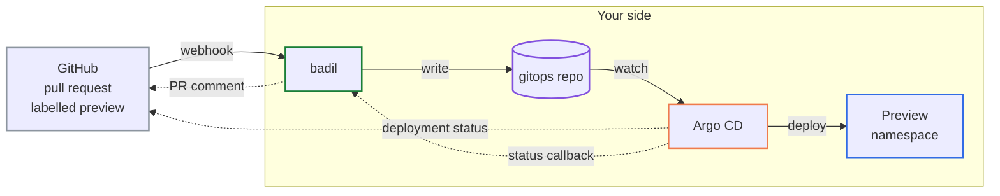
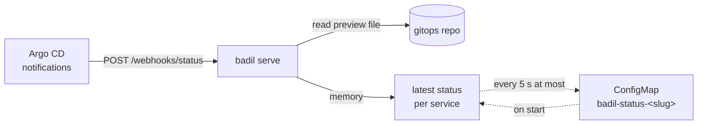

# Architecture

Self-hosted, single-tenant. Everything runs in the user's cluster; badil talks to GitHub through the user's own GitHub App and never touches preview namespaces: ArgoCD does the deploys. badil's only Kubernetes access is the status ConfigMaps of its own namespace (see [Preview status](#preview-status)) and `get` on namespaces by name (see [Namespace in use](EVENTS.md#namespace-in-use)).

- Each service repo's CI builds and pushes its images, and makes no deploy call.
- The deployment status is optional: Argo CD's notifications controller posts it as GitHub Deployments, through its own GitHub App (see [Preview deployments on GitHub](#preview-deployments-on-github)).
- The status callback is optional: the same controller reports each preview service's status to badil (see [Preview status](#preview-status)).
- Closing or unlabelling a PR, and the [cleanup sweep](#cleanup-sweep), unpin services or delete preview files; a push changing `badil.yaml`, or `POST /v1/sync`, resyncs every preview (see [Config sync](#config-sync)); Argo CD prunes what was removed.
- `POST /v1/deploy` and `POST /v1/sync` exist only when `BADIL_DEPLOY_TOKEN` is set. The read routes, `GET /v1/previews` and the waits `GET /v1/wait` and `GET /v1/previews/{slug}/wait`, exist when `BADIL_READ_TOKEN` or `BADIL_DEPLOY_TOKEN` is set.

## Scope

badil has two core jobs. First, it turns pull request events into preview files in the gitops repo, under a published contract. Second, it reports on those previews through PR comments and its read API. Anything about how the workloads run, how the cluster is policed, or one-time setup is the cluster's, the charts' or the user's job.

Out of scope:

- building images;
- workload secrets and registry credentials;
- quotas;
- network and pod security policy;
- seed data;
- testing the preview;
- one-time setup (GitHub App creation).

## Components

badil is a few binaries and charts. Each service repo adds its own chart.

| Component | Where | Role |
|---|---|---|
| `badil serve` | this repo | chi HTTP server: the GitHub webhook, the renderer's status callback, and the optional deploy and sync endpoints. Keeps each preview's status in memory and in a ConfigMap of its namespace. See the [HTTP API reference](API.md). |
| `badil cleanup` | this repo | One-shot [cleanup sweep](#cleanup-sweep), run by a CronJob (hourly). |
| `badil verify-app` | this repo | Check GitHub App credentials and list installations. |
| `preview-apps` chart | this repo, [`charts/preview-apps`](../charts/preview-apps) | The [renderer](CONTRACT.md#preview-contract) badil ships: an AppProject, a Namespace, and one Argo CD Application per service and per dependency. Application annotations `preview.badil.dev/*` carry the PR metadata. |
| ApplicationSet | this repo, [`examples/argocd`](../examples/argocd) | Git directory generator on `previews/*`. |
| Service chart | each service repo | Built on the `app` chart, [`charts/app`](../charts/app). See the [Service repo contract](CONFIGURATION.md#service-repo-contract). |
| `badil` chart | this repo, [`charts/badil`](../charts/badil) | Installs `badil serve` (Deployment, Service, optional Ingress, a Role for the ConfigMaps of its namespace, and a ClusterRole with `get` on namespaces) and the cleanup CronJob (off by default). |

## How a preview flows

The steps from label to teardown:

1. A service repo's CI builds and pushes the image of each commit.
2. A user adds the preview label to a PR. GitHub sends the `pull_request` webhook.
3. badil reads the PR and its labels, and picks the target preview: the PR's branch, or a `preview:<name>` label.
4. badil writes `previews/<slug>/values.yaml` to the gitops repo. The PR's services are pinned at its head SHA, and every other service tracks its branch.
5. badil comments on the PR, with a link per exposed service.
6. The ApplicationSet sees the new directory. Argo CD renders `preview-apps` and deploys the preview namespace, one Application per service and one per dependency.
7. Each push to the PR pins the new head SHA, and Argo CD syncs it.
8. Closing the PR or removing its label unpins its services. When no pin is left, badil deletes the file, and Argo CD prunes the preview.

The [cleanup sweep](#cleanup-sweep) catches what events missed. Every step is detailed in [Pull request events](EVENTS.md), [Services and dependencies](SERVICES.md) and [Cleanup and config sync](CLEANUP.md).

## Reads and writes through the gitops repo

badil does not talk to Argo CD, and its only Kubernetes access is the status ConfigMaps in its own namespace and `get` on namespaces by name. It reads one file, `badil.yaml`, and writes one file per preview. Argo CD does every deploy and deletion.

badil reads the gitops repo from a full git clone of its default branch, made on start in `GITOPS_CLONE_DIR`. Before a read, it checks the remote branch head with `ls-remote`, at most once every 5 seconds, and fetches only when the head moved. A push to the gitops repo makes the next read check at once. A failed check fails the read: badil never reads a clone it could not check.

badil writes by pushing commits to that branch, one commit per operation: a reconcile, across its previews and services, a teardown, a cleanup sweep, a config sync or a manual deploy. An operation fetches the branch, decides on the fetched head what to change, commits that on the head and pushes it without force. When the push is rejected because the head moved, it fetches again, decides again on the new head and pushes again, up to 5 attempts with a backoff of 100 ms doubling to 800 ms. Every check that depends on the repo, such as the holder check, the preview cap or a teardown's update or delete, is decided again on each attempt. The operations of one process run one at a time; an operation waiting for another gives up when its own deadline passes. The pushes authenticate with `GITOPS_REPO_TOKEN`, never as the GitHub App. The commits are authored and committed by `GITOPS_COMMIT_NAME <GITOPS_COMMIT_EMAIL>` when set, else by the GitHub App's bot (`<app-slug>[bot]`), and are signed with `GITOPS_SIGNING_KEY` when set, else unsigned. Each fetch adds a pack to the clone; past 50 packs, the default of git's `gc.autoPackLimit`, badil repacks them into one. `badil serve` listens only once the clone is made: the chart's startup probe allows 5 minutes for it before the liveness probe applies.

`badil.yaml` is the only preview config, and badil is its only reader. badil writes everything a renderer needs into each preview file. The renderer reads only that file, so it can be swapped: [Preview contract](CONTRACT.md) publishes the file for any renderer.

Keys: [Configuration reference](CONFIGURATION.md).

## Pinned and branch-tracking services

A preview runs the full stack, but only the PR's services run its code. Each service runs in one of two modes:

- **Pinned:** the service runs at a commit SHA, the PR head. It changes only when badil writes a new SHA.
- **Branch-tracking:** the service follows its branch (default `main`). Argo CD resolves the image tag to the commit it syncs.

So each service's CI must push an image tagged with the commit SHA, as its `imageTag` format renders it.

How each mode is rendered: [Service modes](SERVICES.md#service-modes). Image tag formats: [`imageTag`](CONFIGURATION.md#imagetag).

### Images that do not exist yet

badil does not check the registry. A service can briefly sit in `ImagePullBackOff` because its image tag does not exist yet:

- a branch-tracking service, when Argo CD syncs a new commit on its branch before that commit's CI has pushed the image;
- a pinned service, because badil pins the PR head SHA as soon as the label or a push arrives. The pod starts when the image is in the registry, and the PR comment says so.

This is accepted because it resolves without intervention. The kubelet keeps retrying the pull, with a back-off capped at 300 seconds. The Applications sync with `selfHeal: true`, and Argo CD polls Git every 3 minutes by default.

These alternatives were considered and not chosen:

- **badil re-pins branch-tracking services** to the branch's new SHA once its image exists. It removes the race, but every build of that branch has to rewrite every active preview, with concurrent writes to the same files.
- **Argo CD webhook from CI** after the image push, instead of polling. It needs CI-to-cluster network access and an exposed Argo CD API, and does not help while Argo CD also polls.
- **Argo CD Image Updater.** Another controller with registry credentials and write-back config, built for tracking the latest tag rather than previews.
- **Init container that waits for the image.** It adds registry access and a wait to every service chart, and still delays startup.
- **badil waits for CI checks or for the image before pinning.** It needs an extra GitHub App permission (Checks) or registry credentials. It delays the other services of the preview, which today start while CI builds, and gains no time (measured: CI 3m34s, pinned service Healthy at 216 s).

## Shared previews

A preview is named by a slug: the PR's branch, or the name of a `preview:<name>` label. PRs from several repos with the same branch or the same named label share one preview. Each pins its own services.

A preview holds one PR per service, so a service is pinned by at most one PR. `preview.maxPreviews` can cap the number of previews.

A preview's slug is its namespace: badil refuses a new preview whose namespace exists and is not a preview namespace, which Argo CD would adopt and the teardown delete.

Rules: [Target preview](EVENTS.md#target-preview), [One PR per service](EVENTS.md#one-pr-per-service), [Preview cap](EVENTS.md#preview-cap) and [Namespace in use](EVENTS.md#namespace-in-use).

## Dependencies and needs

A service often needs a database, a cache or a mail catcher. `dependencies` are upstream charts that badil adds to every preview, next to the services. They are never pinned, get no image tag, and need no git repo of their own.

By default every preview runs every service and dependency. `needs` trims a preview to what its PRs use: a service or dependency lists what it calls, and a preview runs only its pinned services and what they need. badil does not infer `needs`.

Keys: [`dependencies`](CONFIGURATION.md#dependencies) and [`needs`](CONFIGURATION.md#servicesnameneeds-and-dependenciesnameneeds). Rules: [Dependencies](SERVICES.md#dependencies) and [Needs](SERVICES.md#needs).

## Path filters

In a monorepo, one repo holds several services. Without path filters, a labelled PR pins every service of its repo.

`paths` lists the files of a repo that belong to a service. A PR then pins only the services whose files it changes. badil does not infer `paths`, and the PR comment shows which services are pinned.

Key: [`paths`](CONFIGURATION.md#servicesnamepaths). Rules: [Path filters](SERVICES.md#path-filters).

## Cleanup sweep

The cleanup sweep fixes what missed webhooks leave behind, for example when badil was down or a label was renamed.

It runs in the server every `CLEANUP_INTERVAL`, or as the `badil cleanup` CronJob. For each preview, it deletes the file when no service is pinned, or when no deploy happened within `CLEANUP_TTL`. Otherwise it unpins closed PRs, and open PRs whose label moved, conflicts or is gone. It then rewrites every preview it keeps to match `badil.yaml`.

Rules: [Cleanup sweep](CLEANUP.md#cleanup-sweep).

## Config sync

A change to `badil.yaml` should reach running previews without waiting for a push to each PR. Config sync rewrites every preview to match `badil.yaml`, the way the sweep's last step does.

It runs on a push to the gitops repo's default branch, when the App subscribes to `push`, and on `POST /v1/sync`. Without either, the next cleanup sweep applies the change.

Rules: [Config sync](CLEANUP.md#config-sync).

## Preview deployments on GitHub

Argo CD decides whether a preview service is healthy, so its notifications controller posts GitHub Deployments for pinned services, through its own GitHub App. badil posts none.

Triggers and limitations: [Preview deployments on GitHub](OPERATIONS.md#preview-deployments-on-github).

## Preview status

badil does not read what runs in preview namespaces. The renderer reports each preview service's status through the [status callback](CONTRACT.md#status-callback), `POST /webhooks/status`; Argo CD's notifications controller is the reference sender.

- badil records an event only for a preview and a service the gitops repo has, and only when it is not older than the stored status.
- Memory is the source of truth for reads. Each preview's status is written to one ConfigMap of badil's namespace, coalesced, and read back on start, so a restart keeps it.
- A deleted preview loses its status and ConfigMap: at once when the server's own commit deleted it, and otherwise once a fetch moves the gitops repo's head past the deletion (`badil cleanup`, a manual deletion).
- badil's Kubernetes access is limited to its own namespace's ConfigMaps (a Role with get, list, create, update and delete) and `get` on namespaces (a ClusterRole), used only to check a new preview's namespace (see [Namespace in use](EVENTS.md#namespace-in-use)). It never writes namespaces nor reads what is in them; the renderer still does every deploy and deletion.
- The first `ready` of a pinned service at its pinned revision gives its spin-up time.

Details: [Preview status](OPERATIONS.md#preview-status).

## Preview data

badil never reads, writes or drops data stores.

- A preview's identity is its slug: both the Helm release name of `preview-apps` and the preview namespace.
- Each service's release name is the service name, so per-preview data is keyed by namespace.
- Data that lives in the preview namespace is pruned with it on teardown, sweep or expiry.
- Data outside the namespace is owned, and dropped, by whatever provisions it.
- The [`app`](../charts/app) chart only offers `envFrom` and `initContainers` to wire a data provider.

## Code layers

badil's Go packages are grouped in layers, and each package imports only what its row allows.

| Layer | Packages | Imports |
|---|---|---|
| Domain | `internal/preview`, `internal/catalog` | The standard library, yaml.v3, doublestar, jsonschema and other domain packages. |
| Use cases and ports | `internal/forge`, `internal/lifecycle`, `internal/app` | The same libraries, domain and use-case packages. |
| Adapters | `internal/store` (with `internal/store/storetest`), `internal/forge/github` (with `internal/forge/github/githubtest`), `internal/github`, `internal/namespace`, `internal/status`, `internal/status/kube`, `internal/expiry`, `internal/expiry/kube`, `internal/metrics`, `internal/server` (with `internal/server/mocks`), `internal/api`, `internal/apiclient`, `internal/config` | Any library, domain and use cases, and another adapter only as listed below. |
| Tooling | `internal/chartvalues`, `internal/fakegithub`, `internal/archtest`, `cmd/schemagen`, `cmd/fakegithub` | Anything. |
| Composition root | `cmd/badil` | Anything. |

Allowed adapter imports:

- `internal/forge/github` → `internal/github`
- `internal/server` → `internal/api`
- `internal/apiclient` → `internal/api`
- `internal/status/kube` → `internal/status`
- `internal/expiry/kube` → `internal/expiry`
- `internal/config` → `internal/github`

Domain and use-case packages never reach go-git, go-github, ghinstallation, client-go, Prometheus, chi or cobra, not even through another package.

How it is checked:

- The depguard rules of `.golangci.yml` check each file's imports (CI job `golangci-lint`).
- `internal/archtest` checks each package's transitive imports (CI job `test`).
- Test files are exempt from both.
- A new package is added to the table above, to a depguard rule and to the map of `internal/archtest`.
